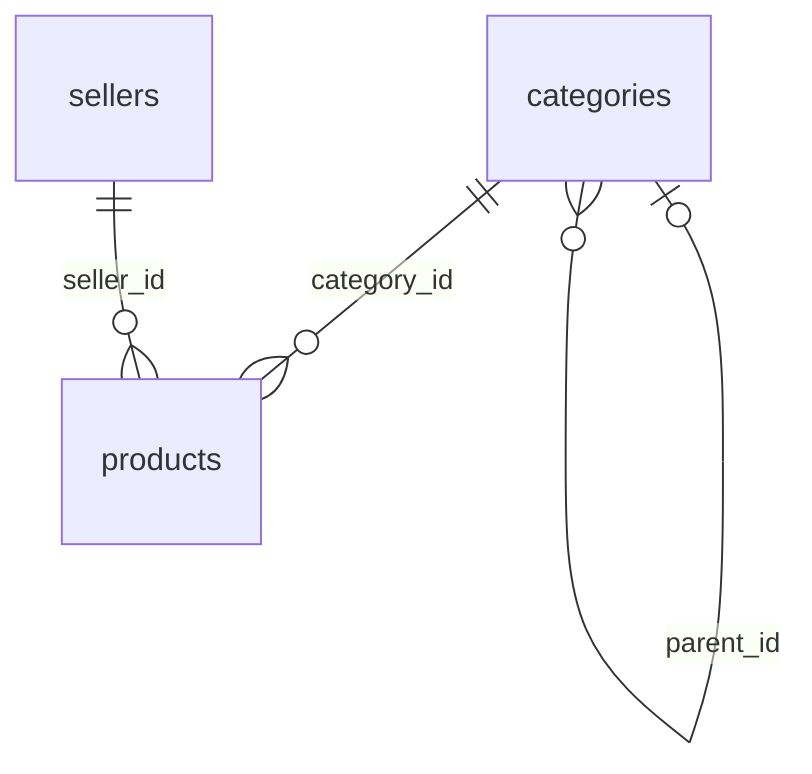

# Bloop4

Plataforma web de **lloguer de material per a esdeveniments**: so, il·luminació, mobiliari,
carpes i estructures. Els clients troben el material que necessiten per organitzar un
esdeveniment, i les empreses de lloguer hi ofereixen el seu catàleg.

## Abast del Sprint 0

El primer sprint construeix la base del catàleg i cobreix dues històries d'usuari:

| Història | Issue | Què permet |
|---|---|---|
| **US-00 · Visualitzar catàleg de productes** | #1 | Veure tots els productes amb nom, categoria, preu per dia i venedor. |
| **US-02 · Filtre del catàleg per categories** | #2 | Filtrar per una o diverses categories (Sonido, Iluminación, Mobiliario, Carpas y estructuras i les seves subcategories). |

Queden fora d'aquest sprint, i són al Product Backlog: cerca per paraula clau, filtres
compartibles per URL, fitxa de producte (imatges, fiança, assegurança), registre i inici de
sessió, reserves i pagaments.

## Stack tecnològic

| Capa | Tecnologia |
|---|---|
| Base de dades | PostgreSQL 16 |
| API | Node.js 22 · Express 5 · `pg` |
| Frontend | React 18 · Vite 5 |
| Servidor web | Nginx |
| Tests | `node:test` (API) · Vitest + Testing Library (frontend) · proves SQL (BD) |
| Contenidors | Docker · Docker Compose |
| CI | GitHub Actions |

## Equip i forma de treballar

Equip de 6 persones: Product Owner, Scrum Master, Backend, Frontend, QA i DevOps.

Treballem amb **GitHub Flow**: una branca per tasca, Pull Request amb revisió i *Squash and
merge* a `main`. El backlog i el tauler són a GitHub Issues i GitHub Projects. Les normes de
branques, commits, revisió i la Definició de Fet són a [CONTRIBUTING.md](CONTRIBUTING.md).

## Estructura del repositori

_Pendent._

## Posada en marxa

_Pendent._

## API

Respostes JSON en camelCase; les llistes van dins de `data`.

| Endpoint | Descripció |
|---|---|
| `GET /api/health` | `200 {"status":"ok"}` si arriba a PostgreSQL, `503` si no |
| `GET /api/categories` | Llista plana de categories amb `parentId`, `slug`, `sortOrder` i `productCount` (productes assignats directament) |
| `GET /api/products` | Productes paginats. `categoryId` (UUID separats per comes; inclou les subcategories), `page` (≥ 1), `pageSize` (1–100, per defecte 24) |

```json
{
  "data": [{
    "id": "d0000000-…-0001",
    "name": "Altavoz activo 12\" 1300 W",
    "dailyPrice": "45.00",
    "currency": "EUR",
    "category":       { "id": "…", "name": "Altavoces", "slug": "altavoces" },
    "parentCategory": { "id": "…", "name": "Sonido",    "slug": "sonido" },
    "seller": { "id": "…", "legalName": "Sonido Levante S.L.", "city": "Valencia" }
  }],
  "pagination": { "page": 1, "pageSize": 24, "totalItems": 15, "totalPages": 1 }
}
```

Errors: `{ "error": { "code", "message", "details?" } }` amb `400 VALIDATION_ERROR`,
`404 NOT_FOUND` o `500 INTERNAL_ERROR` (sense detalls interns).

## Model de dades

Base de dades PostgreSQL 16. L'esquema del catàleg és a
[`db/migrations/001_catalog.sql`](db/migrations/001_catalog.sql) i només conté el que
necessiten US-00 i US-02: categories, venedors i productes.



| Taula | Camps | Regles |
|---|---|---|
| `categories` | `id`, `parent_id`, `name`, `slug`, `sort_order` | Arbre de 2 nivells via `parent_id` (`NULL` = categoria arrel). `slug` únic, en minúscules i amb guions; el frontend fa servir el de l'arrel per triar el color de les targetes. `sort_order` fixa l'ordre dins del filtre. |
| `sellers` | `id`, `legal_name`, `city` | Només el que mostra la targeta de producte: «raó social · ciutat». |
| `products` | `id`, `seller_id`, `category_id`, `name`, `daily_price`, `currency` | `daily_price` és `numeric(12,2)` i ≥ 0 (mai `float`); `currency` és un codi ISO 4217 (per defecte `EUR`). |

Decisions comunes:

- Totes les claus primàries són `uuid` generats amb `gen_random_uuid()`.
- Les claus foranes són `ON DELETE RESTRICT`: no es pot esborrar una categoria o un venedor
  que encara té productes (ni una categoria amb subcategories).
- Els textos obligatoris no poden ser buits (`CHECK (btrim(...) <> '')`).
- Hi ha índexs a `categories.parent_id`, `products.category_id` i `products.seller_id`.
- Filtrar per una categoria pare inclou els productes de les seves subcategories (consulta
  recursiva; vegeu [`db/queries/examples.sql`](db/queries/examples.sql)).

### Dades d'exemple

[`db/seeds/001_catalog.sql`](db/seeds/001_catalog.sql) carrega **2 venedors, 14 categories
(4 arrels i 10 subcategories) i 15 productes**. Els IDs són fixos i llegibles
(`a…` venedors, `c…` categories, `d…` productes) per poder-los referenciar als tests.

| Categoria | Subcategories |
|---|---|
| Sonido | Altavoces · Mesas de mezclas · Microfonía |
| Iluminación | Focos LED · Cabezas móviles · Efectos especiales |
| Mobiliario | Sillas · Mesas |
| Carpas y estructuras | Carpas · Escenarios y tarimas |

### Scripts

Els scripts de `db/` executen `psql` dins del servei `db` de Docker Compose i llegeixen
`.env` si existeix.

| Script | Què fa |
|---|---|
| `./db/migrate.sh` | Aplica en ordre les migracions pendents i les registra a `schema_migrations`. Cada fitxer va en una sola transacció. |
| `./db/seed.sh` | Carrega les dades d'exemple. Falla si ja estan carregades. |
| `./db/reset.sh` | Esborra l'esquema `public` i torna a fer migrate + seed. **Només per a desenvolupament.** |
| `./db/psql.sh` | Obre una sessió de `psql`, o executa el SQL que rep per stdin. |

Per comprovar les dades amb el projecte en marxa:

```bash
./db/psql.sh < db/queries/examples.sql
```

Ha de mostrar els 15 productes, els 5 de Sonido (incloent-hi les subcategories) i les 14
categories amb el recompte de productes.

Les migracions aplicades no es modifiquen mai: qualsevol canvi d'esquema va en una migració
nova (`002_…sql`).

## Tests

_Pendent._
